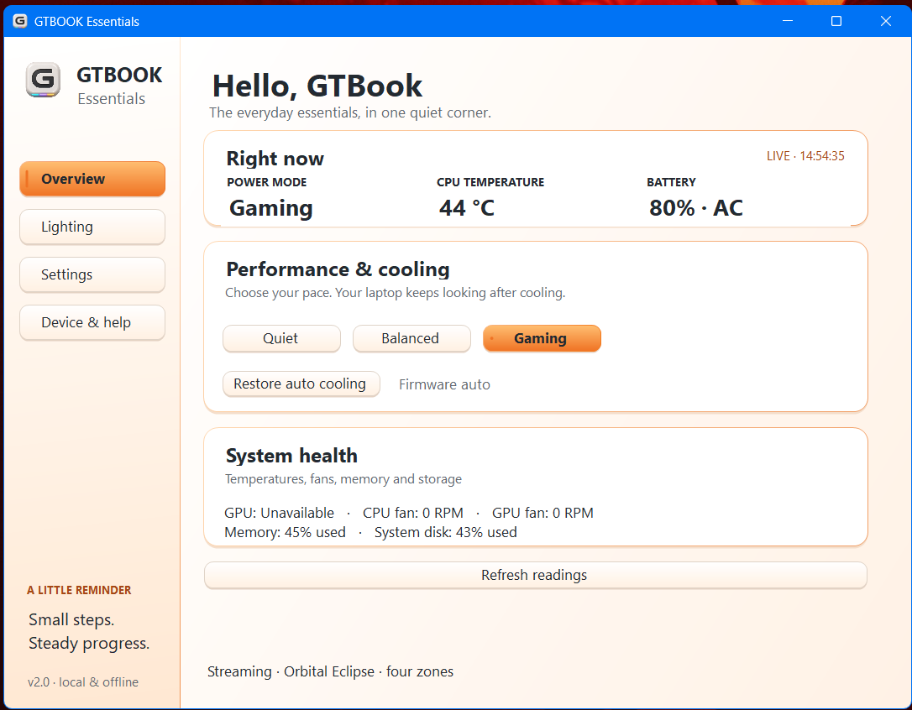
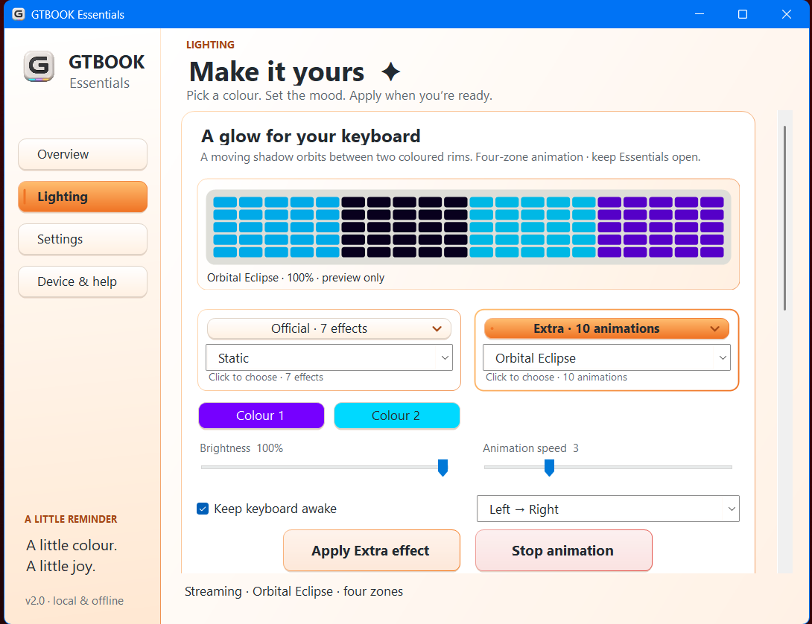
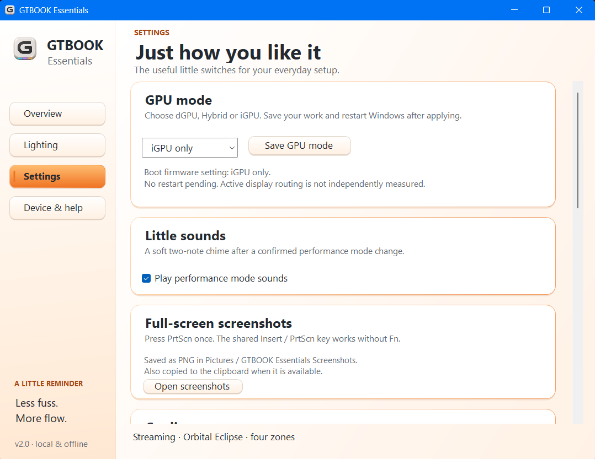
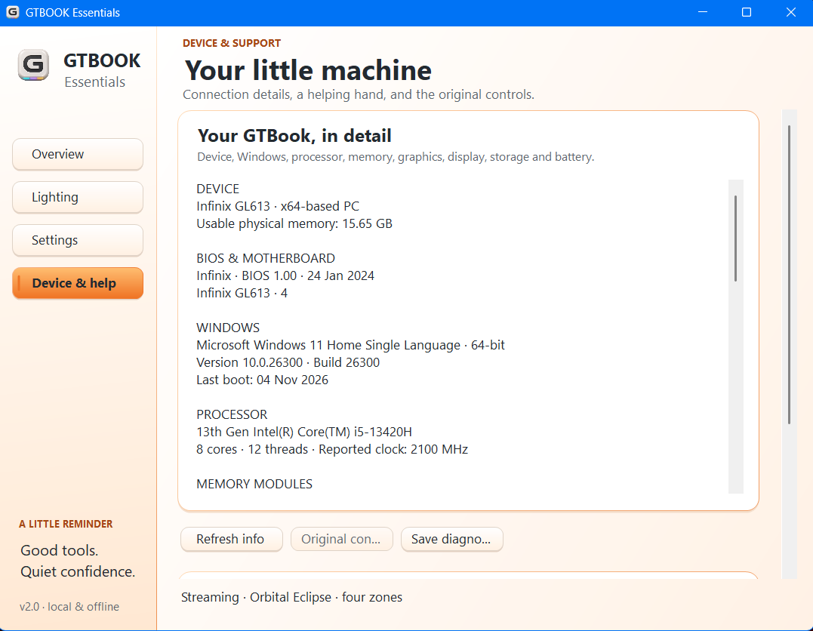
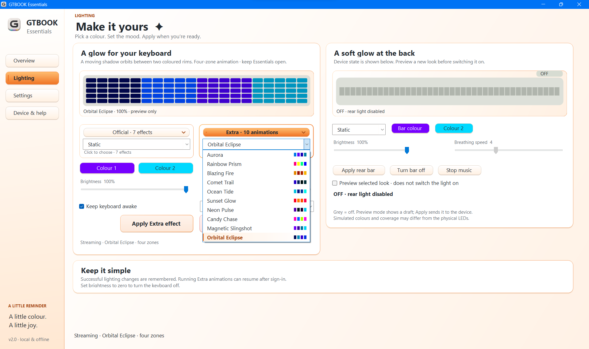

<div align="center">


# GTBOOK Essentials

A small, offline control center for your Infinix GTBook.

**[Download Setup.exe](https://github.com/yashwantmandal26/GTBookEssentials/releases/download/v2.0.0-rc.8/GTBOOK-Essentials-Setup.exe)** · [All downloads](https://github.com/yashwantmandal26/GTBookEssentials/releases) · [Report an issue](https://github.com/yashwantmandal26/GTBookEssentials/issues)
</div>

## Install in 3 steps

1. Download **GTBOOK-Essentials-Setup.exe** above.
2. Double-click it and approve Windows administrator consent using your normal Windows account. Setup checks device support and guides recovery if needed.
3. Open **GTBOOK Essentials** from Start. Future Windows sign-ins start it automatically in the tray.

No Python, Node or separate .NET SDK needed. A ZIP + `Install.bat` alternative is available in Releases. Run a newer Setup.exe to update. Uninstall through **Settings → Apps**.

**Requirements:** Windows 10/11 x64, .NET Framework 4.8 and working Windows ACPI/WMI support. Reviewed hardware: **INFINIX GL613, BIOS 1.00**. Other models/BIOS versions keep native writes disabled; support is not universal across GTBooks. The original Control Center app is not required. Setup checks the firmware interface and attempts safe device rediscovery when it is missing. See [fresh Windows / driver recovery](docs/DRIVER_SUPPORT.md) if controls remain unavailable.

## What it does

- Quiet / Balanced / Gaming, automatic cooling / full fans, temperatures and system readings.
- Official RGB plus **10 four-zone animations**, direction, live previews and independent rear-bar lighting.
- GPU firmware requests, USB charging, screenshots, Windows-key lock and device specifications.
- Window **X hides to tray**; tray **Exit** quits. Routine controls apply with one click.

| Key | Action |
|---|---|
| F1 / F2 | Screen brightness down / up |
| F3 tap | Keyboard brightness |
| F3 hold **0.8 s** | Next effect, once per hold; release to rearm |
| PrtScn | Full-screen PNG → Pictures → GTBOOK Essentials Screenshots |

**GPU changes require a Windows restart.** The app shows the request as pending until reboot; active MUX routing has not been independently verified. USB ON/OFF firmware read-back passed, but physical charging after shutdown still needs a port test. Official lighting uses less background energy than software animations. This is an unsigned community preview; see [validation](docs/VALIDATION.md) for checks and remaining hardware tests.

## Screenshots

Original aspect ratios are preserved. Expand a screenshot for a closer look.

<table>
<tr><td><b>Overview</b><br></td><td><b>Keyboard lighting</b><br></td></tr>
<tr><td><b>Settings</b><br></td><td><b>Device & help</b><br></td></tr>
</table>

**Wide lighting workspace**



## Build from source

```powershell
.\tests\run.ps1
.\Build-Release.ps1
```

Builds the app, one-file setup and ZIPs into `out/` with SHA-256 checksums, using Windows' built-in Framework compiler. No OEM binaries or personal settings are bundled. CI runs software checks without changing hardware.